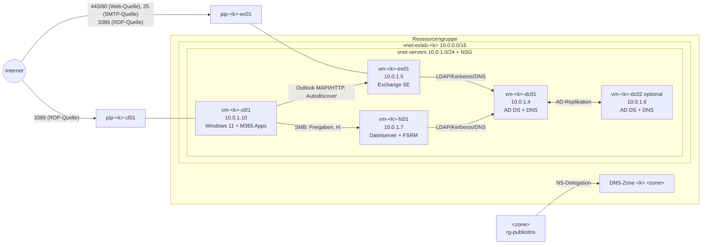

# Architektur

Aufbau des Labs, Ablauf des Deployments, Supportbarkeit und Zertifikat. Für Bereitstellung und Parameter siehe [Bereitstellung](deployment.md), für den Alltag [Betrieb](operations.md).

## Überblick



`<k>` = Kürzel des Azubis (3 Buchstaben), `<zone>` = übergeordnete DNS-Zone (Parameter `parentDnsZoneName`, Name vom Ausbilder).

## Ressourcen

| Ressource | Details |
| --- | --- |
| Domain Controller | `Standard_B2ms`, Windows Server 2025, Forest `<k>.intern` (Functional Level 2016), NTDS/SYSVOL auf eigener Datendisk (Host-Cache None), keine Public IP |
| Zweiter DC (optional) | `deploySecondDc = true`: `<K>-DC02` mit gleicher Ausstattung, wird parallel zum ersten DC aufgebaut und heraufgestuft, DNS des VNets zeigt dann auf beide DCs |
| Exchange-Server | `Standard_E4s_v5` (32 GB RAM), Windows Server 2025, Exchange Server SE (Mailbox), OS- und Datendisk **Premium SSD**, DB und Logs auf ReFS-Datendisk |
| Windows-11-Client | `deployClient = true` (Standard): `<K>-CL01`, `Standard_B2ms`, Windows 11 Enterprise mit deutscher Oberfläche (`labLanguage = en`: englische Oberfläche mit britischen Formaten, Tastatur immer Deutsch), Microsoft 365 Apps (de-de bzw. en-gb, ohne Access/Publisher/Teams), Domänenmitglied in `OU=Computers` der Zentrale, eigene Public IP für RDP, aktualisiert sich selbst (Neustarts nur außerhalb 06–23 Uhr). Einstieg ins Lab: Devolutions Remote Desktop Manager Free mit fertigen RDP-Verbindungen zu allen Lab-Servern (Domain-Admin, für jeden Benutzer am Client) |
| Fileserver | `deployFileServer = true` (Standard): `<K>-FS01`, Windows Server 2025, keine Public IP. Erzeugt die Beispieldaten mit `Standard_D4s_v5` und verkleinert sich danach selbst auf `Standard_B2s_v2` (bietet der Azure-Cluster diese Größe nicht an, auf `Standard_D2s_v5`). Datendisk `F:` mit 256 GB Standard SSD. Freigaben `Abteilungen`, `Projekte`, `Archiv`, `Scans` und `Home$` (englisch `Departments`, `Projects`, `Archive`, `Scans`, `Home$`) mit zugriffsbasierter Aufzählung und AGDLP-Gruppen, Basisordner `H:`, FSRM. Beispieldokumente bis 90 % der Datendisk (rund 230 GB) einer fiktiven Agentur (zwölf Jahre Projekte, Buchhaltung, Personal, Corporate Design, Logos für das Entra-Branding) mit fiktiven personenbezogenen Daten und absichtlichen Altlasten. Definiert in `scripts/data/<Sprache>/FileServer.psd1` und `scripts/data/<Sprache>/corpus` |
| Netzwerk | ein VNet, ein Subnet, eine NSG (kein Allow-All, SMTP getrennt von HTTP/HTTPS), Standard-Public-IPs für Exchange und Client |
| DNS | öffentliche Zone `<k>.<zone>` (mail, autodiscover, MX, SPF, DMARC `p=none`) mit Delegation in `<zone>`; intern Split DNS und Reverse-Zone `1.0.10.in-addr.arpa` auf dem DC |
| AD | OU-Baum `LEARN-<k>` (Branch Berlin/Hamburg bzw. London/Manchester, Administration) und gleichnamige AD-Standorte mit Subnetzen, 28 Lab-Benutzer mit Postfach, Adresse `@<k>.<zone>`, Vorgesetzten, Firma, Land, Telefon, Mobil und Fax. Rufnummern nur fiktiv: Deutsch aus den Bereichen der Bundesnetzagentur für Medienproduktionen (030 23125, 040 66969, 0171 39200), Englisch aus den Ofcom-Drama-Nummern (020 7946 0, 0161 496 0, 07700 900). AD-Papierkorb aktiv |
| Beispielempfänger | Verteiler `geschaeftsleitung`, `marketing-berlin`, `marketing-hamburg`, `vertrieb`, `alle`; freigegebene Postfächer `info`, `buchhaltung` (Vollzugriff mit Automapping, Senden als); Räume `raum-berlin`, `raum-hamburg`; zwei externe Kontakte mit Telefon und Fax. Englisch: `management`, `marketing-london`, `marketing-manchester`, `sales`, `all-staff`; `info`, `accounts`; `room-london`, `room-manchester`. Postfachsprache und Ordnernamen passend zur Lab-Sprache. Definiert in `scripts/data/<Sprache>/LabUsers.psd1` |
| Verwaltung | Remote Desktop Manager auf dem Client als Einstieg zu allen Servern; DNS-Konsole und GPMC zusätzlich auf dem Exchange-Server; GPO `LAB - Outlook klassisch` (englisch `LAB - Classic Outlook`) an `LEARN-<k>` blendet das neue Outlook aus (unterstützt kein Exchange on Premises) |

## Ablauf und Logs

| Schritt | Wo | Log auf der VM |
| --- | --- | --- |
| Forest anlegen, Neustart, Split DNS | DC | `C:\ExchangeLab\Logs\Install-DomainController-*.log` |
| Warten auf DC01, Heraufstufung (optional) | DC02 | `C:\ExchangeLab\Logs\Wait-DomainController.log`, `Install-DomainController-*.log` |
| Heraufstufung nach Neustart (Windows-Wartung hat einen Neustart vorgemerkt oder ein Versuch ist gescheitert, höchstens 3 Neustarts) | DC | `C:\ExchangeLab\Logs\Install-DomainController-Promote.log` |
| Schranke: DC02 vollständig bereit, erst dann VNet-DNS und Exchange (optional) | DC01 | `C:\ExchangeLab\Logs\Wait-SecondDomainController.log` |
| Voraussetzungen, ISO, Zertifikat (parallel) | Exchange | `C:\ExchangeLab\Logs\Initialize-ExchangeServer.log` |
| Sprachpaket, Microsoft 365 Apps, Remote Desktop Manager (parallel) | Client | `C:\ExchangeLab\Logs\Initialize-LabClient-Prepare.log` |
| Warten auf DC, Domänenbeitritt, RDP für Lab-Benutzer, Verbindungen im Remote Desktop Manager | Client | `C:\ExchangeLab\Logs\Wait-DomainController.log`, `Initialize-LabClient-Complete.log` |
| Arbeitsbereich „Lab-Server“ einbinden (Active Setup, erste Anmeldung jedes Benutzers) | Client | `%LOCALAPPDATA%\TraineeLab\Register-LabWorkspace.log` |
| Warten auf DC, Domänenbeitritt | Exchange | `C:\ExchangeLab\Logs\Wait-DomainController.log` |
| Exchange-Setup und Konfiguration | Exchange | `C:\ExchangeLab\Logs\Install-ExchangeServer-*.log`, `C:\ExchangeSetupLogs\` |
| Datendisk, Regionaleinstellungen, Ordnergerüst (parallel) | Fileserver | `C:\ExchangeLab\Logs\Initialize-FileServer-Prepare.log` |
| Beispieldokumente (höchstens 60 Minuten, Rest per Task `TraineeLab-SampleDocuments`) | Fileserver | `C:\ExchangeLab\Logs\New-SampleDocuments*.log`, Stand in `C:\ExchangeLab\sample-documents.json` |
| Warten auf DC, Domänenbeitritt, Rollen, Gruppen, Berechtigungen, Freigaben, Altlasten | Fileserver | `C:\ExchangeLab\Logs\Wait-DomainController.log`, `Initialize-FileServer-Complete.log` |
| Verkleinerung nach Beispieldaten und Updates (Task `TraineeLab-FileServerResize`) | Fileserver | `C:\ExchangeLab\Logs\Resize-FileServer.log` |
| Updates nach der Installation (DCs erst am Ende des Deployments, Run Command `Start-LabUpdate`) | alle Server | `C:\ExchangeLab\Logs\Update-LabServer.log`, auf den DCs auch `Start-LabUpdate.log` |
| tägliche Wartung (Log-Bereinigung, Zertifikat) | Exchange | `C:\ExchangeLab\Logs\Invoke-LabMaintenance.log` |

Status von außen: `az vm run-command show -g <rg> --vm-name vm-<k>-ex01 --name Install-ExchangeServer --instance-view`.

## Kosten und Abschalten

- Die **Exchange-VM** fährt täglich um `autoShutdownTime` (Standard 19:00) herunter und wird deallokiert. Morgens im Portal starten. Der Schedule entsteht erst nach der Installation, das Exchange-Setup wird also nicht unterbrochen. Den Update-Lauf danach kann er aber unterbrechen, deshalb nicht kurz vor der Abschaltzeit deployen.
- Den **DC nie im Portal stoppen oder deallokieren.** Laut Microsoft setzt das Deallokieren die VM-Generation-ID zurück, der DC verwirft seinen RID-Pool und markiert SYSVOL als nicht-autoritativ. Mit nur einem DC gibt es keinen Partner, von dem SYSVOL kommen könnte, dann fehlen NETLOGON und die Gruppenrichtlinien, bis jemand von Hand eingreift. Der DC (`Standard_B2ms`) ist günstig und läuft deshalb durch. Neustarts nur im Gast.
- **Mit zweitem DC:** `<K>-DC02` fährt zusammen mit der Exchange-VM herunter. Beim Start holt er sich SYSVOL vom durchlaufenden `<K>-DC01`. Der erste DC bleibt die Ausnahme und läuft immer. Werden beide DCs gleichzeitig deallokiert, gibt es keinen autoritativen Partner mehr und SYSVOL muss von Hand repariert werden.
- **Client:** `<K>-CL01` fährt ebenfalls zur Abschaltzeit herunter. Windows-Updates installiert er selbst, Neustarts dafür fallen auf das Herunterfahren oder liegen außerhalb 06–23 Uhr.
- **Fileserver:** `<K>-FS01` fährt ebenfalls zur Abschaltzeit herunter. Sind die Beispieldaten bis dahin nicht fertig, setzt der Task `TraineeLab-SampleDocuments` nach dem nächsten Start fort. Deshalb möglichst morgens deployen. `Standard_D4s_v5` kostet pro Stunde etwa viermal so viel wie `Standard_B2s_v2`, läuft aber nur bis zur automatischen Verkleinerung. Die 256-GB-Datendisk kostet auch bei deallokierter VM.
- **Budget:** optional im Portal unter Ressourcengruppe → *Kostenverwaltung* → *Budgets* mit E-Mail-Benachrichtigung anlegen. Nicht im Template, weil Budgets ein Startdatum im laufenden Monat brauchen und Redeploys in späteren Monaten sonst scheitern können.

## Supportbarkeit

| Thema | Stand |
| --- | --- |
| Exchange | Exchange Server SE. Exchange 2016/2019 sind seit 14.10.2025 ohne Support |
| Betriebssystem | Windows Server 2025 Datacenter (unterstützt für Exchange SE und als DC) |
| Trennung | Exchange nicht auf dem DC (Microsoft-Empfehlung) |
| Azure | Alle Exchange-Volumes (DB, Logs, Transport-DB) auf Premium Storage. Das ist Voraussetzung für Support von Exchange auf Azure-VMs |
| AD | Forest-/Domain Functional Level 2016, DC-Datenbank auf Datendisk ohne Schreibcache |
| Updates | Patch-Modus `Manual`: Nach dem ersten automatischen Lauf sind Updates Aufgabe der Administratoren (Exchange-SUs über Microsoft Update) |
| Lizenz | Exchange SE braucht eine Subscription-Lizenz oder Software Assurance. Ohne Product Key läuft der Server 180 Tage als Testversion |
| Sizing | 32 GB RAM liegen unter der Microsoft-Empfehlung von 128 GB. Das reicht fürs Lab, nicht für Produktion |
| PowerShell 7 | Wird auf dem Exchange-Server als Laufzeit für winget installiert, weil die winget-CLI im SYSTEM-Kontext nicht supportet ist und `Microsoft.WinGet.Client` nur unter PowerShell 7 läuft. Exchange nutzt weiterhin ausschließlich Windows PowerShell 5.1; ein Parallelbetrieb ist laut Microsoft zulässig. Auf dem Client ist PowerShell 7 die Laufzeit für das RDM-Modul `Devolutions.PowerShell` |
| Remote Desktop Manager | Devolutions RDM Free mit .NET Desktop Runtime 10 auf dem Client, feste Versionen mit Hash-Prüfung (`scripts/Initialize-LabClient.ps1`). Free ist laut Devolutions für eine Einzelperson lizenziert. Updates sind per Richtlinie ausgeblendet, die Version pflegt das Repository |

## Zertifikat

Das Wildcard-Zertifikat `*.<k>.<zone>` kommt von Let's Encrypt. Die DNS-Challenge erfolgt über die Managed Identity der Exchange-VM, die nur *DNS Zone Contributor* auf der eigenen Zone hat. Die Dateien liegen in `C:\Certificates`, nur für Administratoren lesbar. Das PFX-Passwort ist der Posh-ACME-Standard `poshacme`.

- Gültigkeit 90 Tage. Let's Encrypt erlaubt 50 Zertifikate pro Woche für `<zone>` insgesamt, also für alle Azubis zusammen. Für Testdeployments deshalb `letsEncryptStaging = true` setzen.
- **Erneuerung automatisch:** Der Task `ExchangeLab-Maintenance` (täglich 12:00, bei ausgeschalteter VM nach dem Start) erneuert das Zertifikat, sobald es fällig ist, und bindet es an IIS und SMTP. Derselbe Task löscht IIS- und Exchange-Diagnoselogs, die älter als 14 Tage sind. Message-Tracking-Logs bleiben unberührt.
- Manuell erneuern, falls der Task fehlschlägt (auf dem Exchange-Server, PowerShell als Administrator):

```powershell
$env:POSHACME_HOME = 'C:\ProgramData\Posh-ACME'
Import-Module Posh-ACME
$cert = Submit-Renewal -Force
Copy-Item $cert.PfxFullChain C:\Certificates\ -Force
# danach in der Exchange Management Shell:
$pfx = 'C:\Certificates\fullchain.pfx'
$new = Import-ExchangeCertificate -FileData ([IO.File]::ReadAllBytes($pfx)) -Password (ConvertTo-SecureString 'poshacme' -AsPlainText -Force) -PrivateKeyExportable $true
Enable-ExchangeCertificate -Thumbprint $new.Thumbprint -Services IIS,SMTP -Force
```
