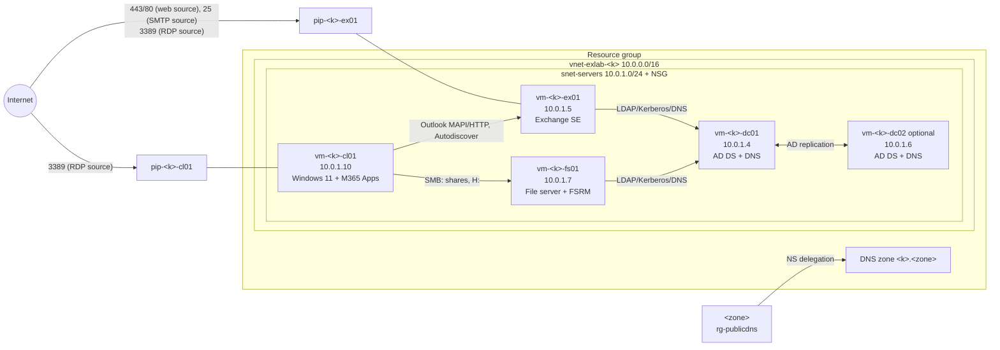

# Architecture

[Deutsch](../de/architecture.md) · **English**

How the lab is built, how the deployment runs, supportability and the certificate. For deployment and parameters see [Deployment](deployment.md), for day-to-day use [Operations](operations.md).

## Overview



`<k>` = the trainee's initials (3 letters), `<zone>` = parent DNS zone (parameter `parentDnsZoneName`, name provided by the trainer).

## Resources

| Resource | Details |
| --- | --- |
| Domain controller | `Standard_B2ms`, Windows Server 2025, forest `<k>.intern` (functional level 2016), NTDS/SYSVOL on a separate data disk (host cache None), no public IP |
| Second DC (optional) | `deploySecondDc = true`: `<K>-DC02` with the same specification, built and promoted in parallel with the first DC; the VNet DNS then points to both DCs |
| Exchange server | `Standard_E4s_v5` (32 GB RAM), Windows Server 2025, Exchange Server SE (Mailbox), OS and data disk **Premium SSD**, database and logs on a ReFS data disk |
| Windows 11 client | `deployClient = true` (default): `<K>-CL01`, `Standard_B2ms`, Windows 11 Enterprise with a German user interface (`labLanguage = en`: English user interface with British formats; keyboard always German), Microsoft 365 Apps (de-de or en-gb, without Access/Publisher/Teams), domain member in `OU=Computers` of the head office, own public IP for RDP, updates itself (restarts only outside 06:00–23:00). Entry point to the lab: Devolutions Remote Desktop Manager Free with ready-made RDP connections to all lab servers (domain admin, for every user on the client) |
| File server | `deployFileServer = true` (default): `<K>-FS01`, Windows Server 2025, no public IP. Generates the sample data as `Standard_D4s_v5` and then shrinks itself to `Standard_B2s_v2` (to `Standard_D2s_v5` if the Azure cluster does not offer that size). Data disk `F:` with 256 GB Standard SSD. Shares `Departments`, `Projects`, `Archive`, `Scans` and `Home$` (German `Abteilungen`, `Projekte`, `Archiv`, `Scans`, `Home$`) with access-based enumeration and AGDLP groups, home folder `H:`, FSRM. Sample documents up to 90 % of the data disk (around 230 GB) from a fictional agency (twelve years of projects, accounting, HR, corporate design, logos for Entra branding) with fictional personal data and deliberate legacy issues. Defined in `scripts/data/<language>/FileServer.psd1` and `scripts/data/<language>/corpus` |
| Network | one VNet, one subnet, one NSG (no allow-all, SMTP separate from HTTP/HTTPS), standard public IPs for Exchange and the client |
| DNS | public zone `<k>.<zone>` (mail, autodiscover, MX, SPF, DMARC `p=none`) delegated from `<zone>`; internally split DNS and reverse zone `1.0.10.in-addr.arpa` on the DC |
| AD | OU tree `LEARN-<k>` (Branch London/Manchester or Berlin/Hamburg, Administration) and AD sites of the same names with subnets, 28 lab users with mailbox, address `@<k>.<zone>`, manager, company, country, phone, mobile and fax. Phone numbers are fictional only: English from the Ofcom drama numbers (020 7946 0, 0161 496 0, 07700 900), German from the Bundesnetzagentur ranges for media productions (030 23125, 040 66969, 0171 39200). AD Recycle Bin enabled |
| Sample recipients | Distribution groups `management`, `marketing-london`, `marketing-manchester`, `sales`, `all-staff`; shared mailboxes `info`, `accounts` (full access with automapping, send as); rooms `room-london`, `room-manchester`; two external contacts with phone and fax. German: `geschaeftsleitung`, `marketing-berlin`, `marketing-hamburg`, `vertrieb`, `alle`; `info`, `buchhaltung`; `raum-berlin`, `raum-hamburg`. Mailbox language and folder names match the lab language. Defined in `scripts/data/<language>/LabUsers.psd1` |
| Administration | Remote Desktop Manager on the client as the entry point to all servers; DNS console and GPMC also on the Exchange server; GPO `LAB - Classic Outlook` (German `LAB - Outlook klassisch`) linked to `LEARN-<k>` hides the new Outlook (it does not support Exchange on-premises) |

## Sequence and logs

| Step | Where | Log on the VM |
| --- | --- | --- |
| Create forest, restart, split DNS | DC | `C:\ExchangeLab\Logs\Install-DomainController-*.log` |
| Wait for DC01, promotion (optional) | DC02 | `C:\ExchangeLab\Logs\Wait-DomainController.log`, `Install-DomainController-*.log` |
| Promotion after restart (Windows maintenance has scheduled a restart or an attempt failed, at most 3 restarts) | DC | `C:\ExchangeLab\Logs\Install-DomainController-Promote.log` |
| Gate: DC02 fully ready, only then VNet DNS and Exchange (optional) | DC01 | `C:\ExchangeLab\Logs\Wait-SecondDomainController.log` |
| Prerequisites, ISO, certificate (in parallel) | Exchange | `C:\ExchangeLab\Logs\Initialize-ExchangeServer.log` |
| Language pack, Microsoft 365 Apps, Remote Desktop Manager (in parallel) | Client | `C:\ExchangeLab\Logs\Initialize-LabClient-Prepare.log` |
| Wait for DC, domain join, RDP for lab users, connections in Remote Desktop Manager | Client | `C:\ExchangeLab\Logs\Wait-DomainController.log`, `Initialize-LabClient-Complete.log` |
| Add the "Lab-Server" workspace (Active Setup, first sign-in of each user) | Client | `%LOCALAPPDATA%\TraineeLab\Register-LabWorkspace.log` |
| Wait for DC, domain join | Exchange | `C:\ExchangeLab\Logs\Wait-DomainController.log` |
| Exchange setup and configuration | Exchange | `C:\ExchangeLab\Logs\Install-ExchangeServer-*.log`, `C:\ExchangeSetupLogs\` |
| Data disk, regional settings, folder structure (in parallel) | File server | `C:\ExchangeLab\Logs\Initialize-FileServer-Prepare.log` |
| Sample documents (at most 60 minutes, the rest via the task `TraineeLab-SampleDocuments`) | File server | `C:\ExchangeLab\Logs\New-SampleDocuments*.log`, progress in `C:\ExchangeLab\sample-documents.json` |
| Wait for DC, domain join, roles, groups, permissions, shares, legacy issues | File server | `C:\ExchangeLab\Logs\Wait-DomainController.log`, `Initialize-FileServer-Complete.log` |
| Resize after sample data and updates (task `TraineeLab-FileServerResize`) | File server | `C:\ExchangeLab\Logs\Resize-FileServer.log` |
| Updates after installation (DCs only at the end of the deployment, Run Command `Start-LabUpdate`) | all servers | `C:\ExchangeLab\Logs\Update-LabServer.log`, on the DCs also `Start-LabUpdate.log` |
| Daily maintenance (log clean-up, certificate) | Exchange | `C:\ExchangeLab\Logs\Invoke-LabMaintenance.log` |

Status from outside: `az vm run-command show -g <rg> --vm-name vm-<k>-ex01 --name Install-ExchangeServer --instance-view`.

## Costs and shutdown

- The **Exchange VM** shuts down daily at `autoShutdownTime` (default 19:00) and is deallocated. Start it in the portal in the morning. The schedule is only created after the installation, so it does not interrupt Exchange setup. It can, however, interrupt the update run that follows, so do not deploy shortly before the shutdown time.
- **Never stop or deallocate the DC in the portal.** According to Microsoft, deallocation resets the VM generation ID; the DC discards its RID pool and marks SYSVOL as non-authoritative. With only one DC there is no partner to get SYSVOL from, so NETLOGON and Group Policy are missing until someone intervenes by hand. The DC (`Standard_B2ms`) is cheap and therefore keeps running. Restart it only from within the guest.
- **With a second DC:** `<K>-DC02` shuts down together with the Exchange VM. On start-up it fetches SYSVOL from `<K>-DC01`, which keeps running. The first DC remains the exception and always runs. If both DCs are deallocated at the same time, there is no authoritative partner left and SYSVOL has to be repaired by hand.
- **Client:** `<K>-CL01` also shuts down at the shutdown time. It installs Windows updates itself; restarts for them happen at shutdown or outside 06:00–23:00.
- **File server:** `<K>-FS01` also shuts down at the shutdown time. If the sample data is not finished by then, the task `TraineeLab-SampleDocuments` continues after the next start. So deploy in the morning if possible. `Standard_D4s_v5` costs about four times as much per hour as `Standard_B2s_v2`, but only runs until the automatic resize. The 256 GB data disk incurs costs even when the VM is deallocated.
- **Budget:** optionally create one in the portal under resource group → *Cost Management* → *Budgets* with an email notification. Not part of the template, because budgets need a start date in the current month and redeployments in later months could otherwise fail.

## Supportability

| Topic | Status |
| --- | --- |
| Exchange | Exchange Server SE. Exchange 2016/2019 have been out of support since 14 October 2025 |
| Operating system | Windows Server 2025 Datacenter (supported for Exchange SE and as a DC) |
| Separation | Exchange not on the DC (Microsoft recommendation) |
| Azure | All Exchange volumes (database, logs, transport database) on Premium Storage. This is a prerequisite for support of Exchange on Azure VMs |
| AD | Forest/domain functional level 2016, DC database on a data disk without write cache |
| Updates | Patch mode `Manual`: after the first automatic run, updates are the administrators' job (Exchange SUs via Microsoft Update) |
| Licence | Exchange SE requires a subscription licence or Software Assurance. Without a product key the server runs as a trial for 180 days |
| Sizing | 32 GB RAM is below Microsoft's recommendation of 128 GB. Enough for the lab, not for production |
| PowerShell 7 | Installed on the Exchange server as the runtime for winget, because the winget CLI is not supported in the SYSTEM context and `Microsoft.WinGet.Client` only runs under PowerShell 7. Exchange continues to use Windows PowerShell 5.1 exclusively; Microsoft permits running both side by side. On the client, PowerShell 7 is the runtime for the RDM module `Devolutions.PowerShell` |
| Remote Desktop Manager | Devolutions RDM Free with .NET Desktop Runtime 10 on the client, pinned versions with hash check (`scripts/Initialize-LabClient.ps1`). According to Devolutions, Free is licensed for a single individual. Updates are hidden by policy; the repository maintains the version |

## Certificate

The wildcard certificate `*.<k>.<zone>` comes from Let's Encrypt. The DNS challenge uses the managed identity of the Exchange VM, which only has *DNS Zone Contributor* on its own zone. The files are in `C:\Certificates`, readable by administrators only. The PFX password is the Posh-ACME default `poshacme`.

- Valid for 90 days. Let's Encrypt allows 50 certificates per week for `<zone>` in total, i.e. for all trainees together. For test deployments, set `letsEncryptStaging = true`.
- **Automatic renewal:** The task `ExchangeLab-Maintenance` (daily at 12:00, after start-up if the VM was off) renews the certificate when it is due and binds it to IIS and SMTP. The same task deletes IIS and Exchange diagnostic logs older than 14 days. Message tracking logs are left untouched.
- Renew manually if the task fails (on the Exchange server, PowerShell as administrator):

```powershell
$env:POSHACME_HOME = 'C:\ProgramData\Posh-ACME'
Import-Module Posh-ACME
$cert = Submit-Renewal -Force
Copy-Item $cert.PfxFullChain C:\Certificates\ -Force
# then in the Exchange Management Shell:
$pfx = 'C:\Certificates\fullchain.pfx'
$new = Import-ExchangeCertificate -FileData ([IO.File]::ReadAllBytes($pfx)) -Password (ConvertTo-SecureString 'poshacme' -AsPlainText -Force) -PrivateKeyExportable $true
Enable-ExchangeCertificate -Thumbprint $new.Thumbprint -Services IIS,SMTP -Force
```
