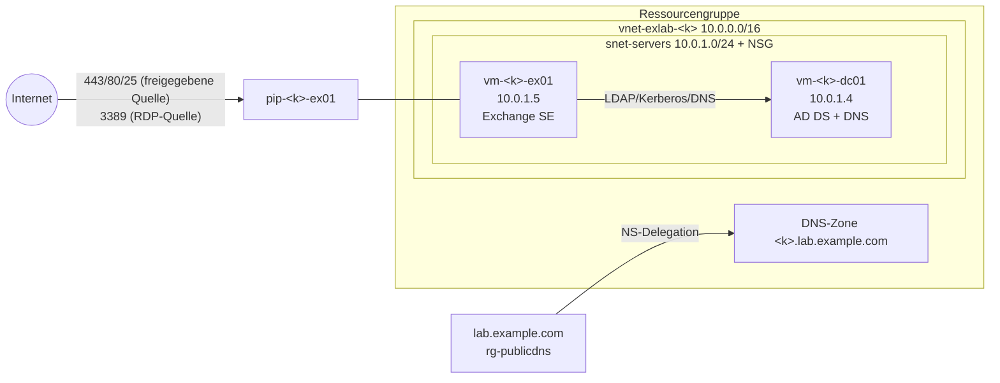

# Exchange Server SE Lab (Azure)

[](https://portal.azure.com/#create/Microsoft.Template/uri/https%3A%2F%2Fraw.githubusercontent.com%2Fsredlin%2FExchangeSELab%2Fmaster%2Fazuredeploy.json)

Lab-Umgebung für die Ausbildung: ein **Domain Controller** und ein **Exchange Server SE** auf getrennten VMs mit Windows Server 2025. Nach dem Deployment ist alles fertig eingerichtet: Split DNS, Let's-Encrypt-Zertifikat, URLs, Accepted Domain und Postfächer für 12 Lab-Benutzer.

## Architektur



`<k>` = Kürzel des Azubis (3 Buchstaben).

| Ressource | Details |
| --- | --- |
| Domain Controller | `Standard_B2ms`, Windows Server 2025, Forest `<k>.intern` (Functional Level 2016), NTDS/SYSVOL auf eigener Datendisk (Host-Cache None), keine Public IP |
| Exchange-Server | `Standard_E4s_v5` (32 GB RAM), Windows Server 2025, Exchange Server SE (Mailbox), OS- und Datendisk **Premium SSD**, DB und Logs auf ReFS-Datendisk |
| Netzwerk | ein VNet, ein Subnet, eine NSG (kein Allow-All), eine Standard-Public-IP |
| DNS | öffentliche Zone `<k>.lab.example.com` (mail, autodiscover, MX) mit Delegation in `lab.example.com`; intern Split DNS auf dem DC |
| AD | OU-Baum `LEARN-<k>` (Branch Kiel/Hamburg, Administration), 12 Lab-Benutzer mit Postfach und Adresse `@<k>.lab.example.com` |

## Voraussetzungen

- **Rechte:** Owner auf der eigenen Ziel-Ressourcengruppe (für die Rollenzuweisung der Managed Identity) und *DNS Zone Contributor* auf `rg-publicdns`. Eine Entra-/Global-Admin-Rolle ist **nicht** nötig. Ohne Owner: Parameter `enableLetsEncrypt = false`.
- **Kürzel** darf noch nicht als Subdomain in `lab.example.com` existieren.
- **Kontingent:** 6 vCPU (2 × BS-Familie, 4 × ESv5-Familie) in der Region.

## Bereitstellen

1. **Deploy to Azure** klicken, Ressourcengruppe wählen (z. B. `rg-exlab-<k>`).
2. Parameter ausfüllen:

   | Parameter | Pflicht | Bedeutung |
   | --- | --- | --- |
   | `trainee` | ja | Kürzel, 3 Buchstaben |
   | `adminPassword` | ja | Passwort für `vbu-adm` (lokal, Domain-Admin, DSRM) |
   | `allowedRdpSourcePrefix` | ja | eigene öffentliche IP, z. B. `203.0.113.10/32` |
   | `labUserPassword` | nein | Passwort der 12 Lab-Benutzer, leer = `adminPassword` |
   | `exchangePublishedSourcePrefix` | nein | Quelle für 443/80/25, leer = wie RDP. Erst nach dem Update-Lauf auf `Internet` stellen |
   | `enableLetsEncrypt` / `letsEncryptStaging` | nein | Zertifikat an/aus, Test-CA für Testdeployments |
   | `wingetPackages` | nein | zusätzliche Tools per winget, Standard `Microsoft.VisualStudioCode` |

3. Das Deployment dauert **ca. 1–1,5 Stunden**. Im Test waren es rund 65 Minuten, davon allein 31 Minuten Exchange-Setup. Danach startet der Exchange-Server neu und installiert im Hintergrund alle Updates, inklusive Exchange-Sicherheitsupdate über Microsoft Update. Der DC macht das parallel. Rechne mit weiteren 30–60 Minuten.

### Ablauf und Logs

| Schritt | Wo | Log auf der VM |
| --- | --- | --- |
| Forest anlegen, Neustart, Split DNS | DC | `C:\ExchangeLab\Logs\Install-DomainController-*.log` |
| Voraussetzungen, ISO, Zertifikat (parallel) | Exchange | `C:\ExchangeLab\Logs\Initialize-ExchangeServer.log` |
| Warten auf DC, Domänenbeitritt | Exchange | `C:\ExchangeLab\Logs\Wait-DomainController.log` |
| Exchange-Setup und Konfiguration | Exchange | `C:\ExchangeLab\Logs\Install-ExchangeServer-*.log`, `C:\ExchangeSetupLogs\` |
| Updates nach der Installation | beide | `C:\ExchangeLab\Logs\Update-LabServer.log` |

Status von außen: `az vm run-command show -g <rg> --vm-name vm-<k>-ex01 --name Install-ExchangeServer --instance-view`.

## Nach dem Deployment

- **RDP:** auf den Exchange-Server (Ausgabe `rdpHost`) als `<K>\vbu-adm`. Den DC erreichst du per RDP vom Exchange-Server aus (`<K>-DC01`).
- **OWA/ECP:** `https://mail.<k>.lab.example.com/owa` bzw. `/ecp`, z. B. als `mmustermann@<k>.lab.example.com`.
- **Von außen erreichbar machen:** erst wenn `Update-LabServer.log` fertig ist, die NSG-Regel `Allow-Exchange-Published` auf Quelle `Internet` stellen.
- **Ausgehende Mails** an fremde Domains gehen aus Azure nur supportet über einen Smart Host (Send Connector mit Relay). Das ist bewusst nicht vorkonfiguriert.

## Supportbarkeit

| Thema | Stand |
| --- | --- |
| Exchange | Exchange Server SE. Exchange 2016/2019 sind seit 14.10.2025 ohne Support |
| Betriebssystem | Windows Server 2025 Datacenter (unterstützt für Exchange SE und als DC) |
| Trennung | Exchange nicht auf dem DC (Microsoft-Empfehlung) |
| Azure | Alle Exchange-Volumes (DB, Logs, Transport-DB) auf Premium Storage. Das ist Voraussetzung für Support von Exchange auf Azure-VMs |
| AD | Forest-/Domain Functional Level 2016, DC-Datenbank auf Datendisk ohne Schreibcache |
| Updates | Patch-Modus `Manual`: Nach dem ersten automatischen Lauf sind Updates Aufgabe der Administratoren (Exchange-SUs über Microsoft Update) |
| Lizenz | Exchange SE braucht eine Subscription-Lizenz oder Software Assurance. Ohne Product Key läuft der Server 180 Tage als Testversion |
| Sizing | 32 GB RAM liegen unter der Microsoft-Empfehlung von 128 GB. Das reicht fürs Lab, nicht für Produktion |
| PowerShell 7 | Wird auf dem Exchange-Server als Laufzeit für winget installiert, weil die winget-CLI im SYSTEM-Kontext nicht supportet ist und `Microsoft.WinGet.Client` nur unter PowerShell 7 läuft. Exchange nutzt weiterhin ausschließlich Windows PowerShell 5.1; ein Parallelbetrieb ist laut Microsoft zulässig |

Den DC nicht über das Portal stoppen oder deallokieren, sondern im Gast herunterfahren (VM-Generation-ID, RID-Pool).

## Zertifikat

Das Wildcard-Zertifikat `*.<k>.lab.example.com` kommt von Let's Encrypt. Die DNS-Challenge erfolgt über die Managed Identity der Exchange-VM, die nur *DNS Zone Contributor* auf der eigenen Zone hat. Die Dateien liegen in `C:\Certificates`, nur für Administratoren lesbar. Das PFX-Passwort ist der Posh-ACME-Standard `poshacme`.

- Gültigkeit 90 Tage. Let's Encrypt erlaubt 50 Zertifikate pro Woche für `lab.example.com` insgesamt, also für alle Azubis zusammen. Für Testdeployments deshalb `letsEncryptStaging = true` setzen.
- Erneuern (auf dem Exchange-Server, PowerShell als Administrator):

```powershell
$env:POSHACME_HOME = 'C:\ProgramData\Posh-ACME'
Import-Module Posh-ACME
$cert = Submit-Renewal -Force
Copy-Item $cert.PfxFullChain C:\Certificates\ -Force
# danach in der Exchange Management Shell:
$pfx = 'C:\Certificates\fullchain.pfx'
$new = Import-ExchangeCertificate -FileData ([IO.File]::ReadAllBytes($pfx)) -Password (ConvertTo-SecureString 'poshacme' -AsPlainText -Force) -PrivateKeyExportable $true
Enable-ExchangeCertificate -Thumbprint $new.Thumbprint -Services IIS,SMTP -Force
```

## Aufräumen

Beim Löschen eines Labs immer auch die Delegation entfernen, sonst bleibt ein verwaister NS-Eintrag stehen (Gefahr einer Subdomain-Übernahme):

```bash
az group delete -n rg-exlab-<k>
az network dns record-set ns delete -g rg-publicdns -z lab.example.com -n <k>
```

## Entwicklung

- Quellcode: `infra/` (Bicep) und `scripts/` (PowerShell, nur ASCII, Windows PowerShell 5.1). Die Skripte werden per `loadTextContent` ins Template eingebettet, es gibt keine Downloads aus dem Repo.
- `azuredeploy.json` wird **generiert**, nie von Hand bearbeiten:

```bash
az bicep build --file infra/main.bicep --outfile azuredeploy.json
```

- Prüfungen (laufen auch in der CI):

```powershell
Invoke-ScriptAnalyzer -Path scripts -Recurse -Settings ./PSScriptAnalyzerSettings.psd1
Invoke-Pester -Path tests
```

## Hinweis für Betreiber

Ältere Versionen dieses Templates haben ein Service-Principal-Secret für Let's Encrypt im Klartext übergeben. Das Secret steht in der Deployment-Historie aller damit erstellten Ressourcengruppen. **Secret rotieren oder den Service Principal löschen**, falls noch nicht geschehen.
