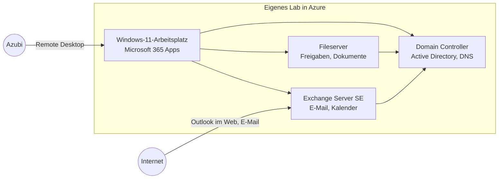

# Trainee Lab (Azure)

Eine komplette Microsoft-Firmenumgebung zum Lernen und Üben, per Klick in Azure.

## Inhalt

- [Deutsch](#deutsch)
  - [Wozu das Ganze?](#wozu-das-ganze)
  - [Für wen?](#für-wen)
  - [Was steckt drin?](#was-steckt-drin)
  - [Was lässt sich üben?](#was-lässt-sich-üben)
  - [Schnellstart](#schnellstart)
  - [Kosten](#kosten)
  - [Dokumentation](#dokumentation)
  - [Hinweis für Betreiber](#hinweis-für-betreiber)
  - [Unterstützen](#unterstützen)
  - [Lizenz](#lizenz)

## Deutsch

Das Trainee Lab baut in Azure die IT einer fiktiven Firma auf, fertig eingerichtet: Active Directory, Exchange Server, Fileserver und einen Windows-11-Arbeitsplatz mit Microsoft 365 Apps. Mitarbeitende, Postfächer, Abteilungsordner und zwölf Jahre Firmendokumente sind schon da. Hier darf geübt, ausprobiert, kaputtgemacht und neu aufgesetzt werden, ohne dass ein produktives System etwas davon merkt.

### Wozu das Ganze?

Wer IT-Infrastruktur lernt, braucht eine Umgebung, in der Fehler erlaubt sind. Echte Systeme sind dafür tabu. Ein Lab von Hand aufzubauen kostet Ausbilder viel Zeit und sieht am Ende bei jedem Azubi ein bisschen anders aus.

Das Trainee Lab löst das:

- **Immer wieder dieselbe Umgebung.** Jedes Deployment liefert denselben Ausgangsstand, ohne Handarbeit. Alle Azubis starten gleich, Ergebnisse sind vergleichbar.
- **Kaputtmachen erlaubt.** Ist das Lab verkonfiguriert, wird es gelöscht und neu bereitgestellt. Danach ist alles wieder wie am ersten Tag.
- **Realistisch statt leer.** Statt einer leeren Domäne gibt es eine Firma mit Standorten, Mitarbeitenden, Verteilern, Freigaben, Dokumenten und den typischen Altlasten gewachsener Umgebungen.
- **Ein eigenes Lab pro Azubi**, getrennt von allen anderen und von der Firmen-IT.

### Für wen?

#### IT-Leiter

- Jedes Lab läuft abgeschottet in einer eigenen Azure-Ressourcengruppe, ohne Verbindung zur Produktivumgebung und zum Firmen-Tenant.
- Keine Global-Admin-Rechte nötig: Die Azubis brauchen nur Rechte auf ihre eigene Ressourcengruppe und die gemeinsame DNS-Zone.
- Kosten planbar: Die Server schalten sich abends selbst ab, der Fileserver verkleinert sich nach dem Aufbau.
- Von außen nur von freigegebenen IP-Adressen erreichbar.
- Aktuelle, supportete Versionen: Exchange Server SE, Windows Server 2025, Windows 11.
- Lizenzen: Windows 11 in Azure und Microsoft 365 Apps brauchen passende Firmenlizenzen, Exchange läuft ohne Product Key 180 Tage als Testversion. Details in der [Bereitstellung](docs/de/deployment.md#voraussetzungen).

#### Ausbildungsleiter

- Immer wieder dieselbe Umgebung für alle Azubis, gut für gemeinsame Übungen und vergleichbare Ergebnisse.
- Wahlweise auf Deutsch (Mustermann Medien GmbH) oder Englisch (Contoso Ltd).
- Das Lab baut sich ohne Eingriff auf und lässt sich am Ende automatisch auf Vollständigkeit prüfen.
- Abbau und Neuaufbau jederzeit, zum Beispiel für jeden neuen Jahrgang.
- Grundlage für eigene Übungen, von der Benutzerverwaltung bis zur Migration in die Cloud.

#### Auszubildende

- Eine Firma zum Anfassen: Kolleginnen und Kollegen mit Postfach, Abteilungen, Verteiler, Besprechungsräume, Freigaben und jede Menge Dokumente.
- Einstieg wie im Büro: Anmeldung am eigenen Windows-11-Arbeitsplatz mit Outlook, Word und Co., von dort weiter auf alle Server.
- Ausprobieren ohne Angst: Was kaputtgeht, ist nach einem Neuaufbau wieder da.
- Echte Aufgaben statt Trockenübung: gewachsene Berechtigungen, alte Dateien und Datenschutzprobleme warten aufs Aufräumen.

#### Microsoft-Interessierte

- Aktueller On-Premises-Stack: Active Directory, Exchange Server SE, Windows Server 2025, Windows 11 mit Microsoft 365 Apps.
- Eigene öffentliche Maildomain mit echtem Zertifikat von Let's Encrypt, wie in einer richtigen Firma.
- Komplett als Code im Repository: nachvollziehbar, wie sich eine solche Umgebung automatisch aufbauen lässt.
- Ausgangslage für den Weg in die Cloud: Entra Connect, Exchange Hybrid, SharePoint Online.

### Was steckt drin?

- **Die Firma:** eine fiktive Werbeagentur, auf Deutsch die Mustermann Medien GmbH mit Standorten in Berlin und Hamburg, auf Englisch die Contoso Ltd in London und Manchester.
- **Die Mitarbeitenden:** 28 Benutzer mit Postfach, Abteilung, Vorgesetzten und Telefonnummern, darunter die 16 bekannten Microsoft-Demo-Personas wie Adele Vance oder Megan Bowen.
- **Die Server:**
  - Domain Controller mit Active Directory und DNS, auf Wunsch ein zweiter für Ausfallsicherheit
  - Exchange Server SE mit Postfächern, Verteilern, freigegebenen Postfächern, Besprechungsräumen und Outlook im Web
  - Fileserver mit Abteilungs-, Projekt-, Archiv- und Scan-Freigaben sowie persönlichen Basisordnern
  - Windows-11-Arbeitsplatz mit Microsoft 365 Apps, fertig eingerichtetem Outlook und Remote Desktop Manager für den Weg zu allen Servern
- **Die Daten:** rund 230 GB Word-, Excel-, PowerPoint- und PDF-Dateien aus zwölf Jahren Firmengeschichte, von Kundenprojekten über Buchhaltung und Personal bis zum Corporate Design.
- **Die Altlasten:** absichtlich eingebaut, wie in jeder gewachsenen Umgebung: Kopien und alte Versionen, Rechte für einzelne Benutzer statt Gruppen, Bewerbungen für alle lesbar, Rechte eines längst gelöschten Praktikanten, ein privater Ordner, auf den kein Admin zugreifen kann, und eine Scan-Freigabe mit Vollzugriff für jeden.

### Was lässt sich üben?

Vom eigenen Rechenzentrum bis in die Cloud, zum Beispiel:

- **Active Directory:** Benutzer, Gruppen und OUs verwalten, Gruppenrichtlinien, Standorte, zweiter Domain Controller und Ausfallsicherheit, gelöschte Objekte wiederherstellen
- **DNS und Zertifikate:** interne und öffentliche Namensauflösung, Zertifikate erneuern und einbinden
- **Exchange:** Postfächer, Verteiler, freigegebene Postfächer und Räume, Berechtigungen, Updates
- **Fileserver:** Freigaben und Berechtigungen nach AGDLP, Altlasten finden, bewerten und beheben, Datenschutz
- **Hybrid:** Entra Connect zur Synchronisierung mit einem eigenen Microsoft-365-Testtenant (nicht dem Firmen-Tenant), Exchange Hybrid und Postfachmigration nach Exchange Online
- **Cloud-Migration:** Dateien vom Fileserver nach SharePoint Online bringen

### Schnellstart

1. **Vorbereiten:** Azure-Subscription mit Rechten auf eine eigene Ressourcengruppe, Kürzel und DNS-Zone vom Ausbilder, die eigene öffentliche IP-Adresse sowie passende Lizenzen für Windows 11 und Microsoft 365 Apps.
2. **Bereitstellen:** Oben auf *Deploy to Azure* klicken und das Formular ausfüllen.
3. **Abwarten:** Das Lab baut sich ohne Eingriff auf, inklusive Updates und Beispieldaten. Das dauert mehrere Stunden, deshalb am besten morgens starten.
4. **Loslegen:** Per Remote Desktop am Windows-11-Arbeitsplatz anmelden, von dort geht es zu allen Servern.

Alle Voraussetzungen, Einstellungen und ersten Schritte: [Bereitstellung](docs/de/deployment.md).

### Kosten

Das Lab läuft in der eigenen Azure-Subscription und kostet, solange es existiert. Größter Posten ist der Exchange-Server. Damit es günstig bleibt:

- Exchange-Server, Arbeitsplatz und Fileserver schalten sich jeden Abend selbst ab. Abgeschaltete Server kosten nur noch ihren Speicher.
- Der Domain Controller ist klein und läuft bewusst durch, damit das Active Directory stabil bleibt.
- Der Fileserver arbeitet nur beim Aufbau mit mehr Leistung und verkleinert sich danach selbst.
- Wird das Lab nicht mehr gebraucht, wird es komplett gelöscht.

Budgets, vorzeitiges Abschalten und Abbau: [Betrieb](docs/de/operations.md#kosten-im-blick-behalten).

### Dokumentation

| Dokument | Für | Inhalt |
| --- | --- | --- |
| [Bereitstellung](docs/de/deployment.md) | alle, die ein Lab aufsetzen | Voraussetzungen, Rechte, Lizenzen, Parameter, Dauer, erste Schritte |
| [Architektur](docs/de/architecture.md) | IT-Leiter, Technikinteressierte | Aufbau, Netzwerk, Server, Ablauf und Logs, Supportbarkeit, Zertifikat |
| [Betrieb](docs/de/operations.md) | Azubis, Ausbilder | Starten und Stoppen, neue IP-Adresse, Lab prüfen, Fileserver, Kosten, Abbau |
| [Troubleshooting](docs/de/troubleshooting.md) | Azubis, Ausbilder | Hilfe, wenn etwas nicht läuft |
| [Entwicklung](docs/de/development.md) | Mitwirkende | Aufbau des Repositorys, Build, Tests, Abnahme |
| [Textkorpus](scripts/data/README.md) | Mitwirkende | Regeln für die Beispieldokumente |

### Hinweis für Betreiber

Ältere Versionen dieses Templates haben ein Service-Principal-Secret für Let's Encrypt im Klartext übergeben. Das Secret steht in der Deployment-Historie aller damit erstellten Ressourcengruppen. **Secret rotieren oder den Service Principal löschen**, falls noch nicht geschehen.

### Unterstützen

Das Lab ist kostenlos und quelloffen. Wer die Weiterentwicklung unterstützen möchte, kann das über [Buy Me a Coffee](https://buymeacoffee.com/sredlin) tun. Danke!

### Lizenz

[MIT](LICENSE). Exchange Server, Microsoft 365 Apps, CSS-Exchange und weitere Software lädt das Lab zur Laufzeit von den Herstellern. Dafür gelten deren Lizenzbedingungen.
