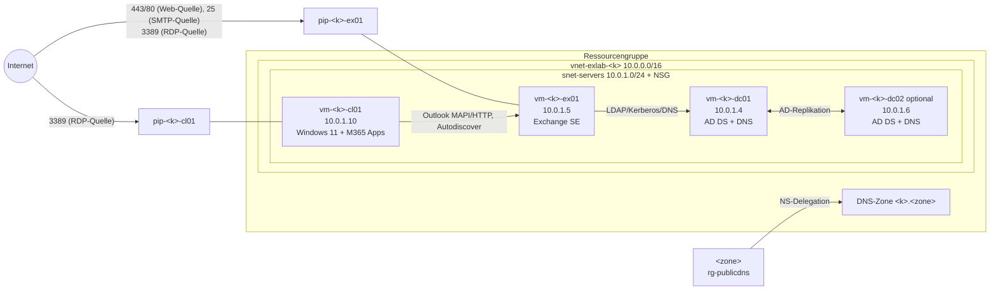

# Trainee Lab (Azure)

[](https://portal.azure.com/#create/Microsoft.Template/uri/https%3A%2F%2Fraw.githubusercontent.com%2Fsredlin%2FTraineeLab%2Fmaster%2Fazuredeploy.json)

Lab-Umgebung für die Ausbildung: ein **Domain Controller** und ein **Exchange Server SE** auf getrennten VMs mit Windows Server 2025, dazu ein **Windows-11-Client** mit Microsoft 365 Apps. Nach dem Deployment ist alles fertig eingerichtet: Split DNS, Let's-Encrypt-Zertifikat, URLs, Accepted Domain, Postfächer für 12 Lab-Benutzer und Beispielempfänger (Verteiler, freigegebene Postfächer, Räume, Kontakte) als Ausgangspunkt für Übungen.

## Architektur



`<k>` = Kürzel des Azubis (3 Buchstaben), `<zone>` = übergeordnete DNS-Zone (Parameter `parentDnsZoneName`, Name vom Ausbilder).

| Ressource | Details |
| --- | --- |
| Domain Controller | `Standard_B2ms`, Windows Server 2025, Forest `<k>.intern` (Functional Level 2016), NTDS/SYSVOL auf eigener Datendisk (Host-Cache None), keine Public IP |
| Zweiter DC (optional) | `deploySecondDc = true`: `<K>-DC02` mit gleicher Ausstattung, wird parallel zum ersten DC aufgebaut und heraufgestuft, DNS des VNets zeigt dann auf beide DCs |
| Exchange-Server | `Standard_E4s_v5` (32 GB RAM), Windows Server 2025, Exchange Server SE (Mailbox), OS- und Datendisk **Premium SSD**, DB und Logs auf ReFS-Datendisk |
| Windows-11-Client | `deployClient = true` (Standard): `<K>-CL01`, `Standard_B2ms`, Windows 11 Enterprise mit deutscher Oberfläche, Microsoft 365 Apps (de-de, ohne Access/Publisher/Teams), Domänenmitglied in `OU=Computers,OU=Kiel`, eigene Public IP für RDP, aktualisiert sich selbst (Neustarts nur außerhalb 06–23 Uhr) |
| Netzwerk | ein VNet, ein Subnet, eine NSG (kein Allow-All, SMTP getrennt von HTTP/HTTPS), Standard-Public-IPs für Exchange und Client |
| DNS | öffentliche Zone `<k>.<zone>` (mail, autodiscover, MX, SPF, DMARC `p=none`) mit Delegation in `<zone>`; intern Split DNS und Reverse-Zone `1.0.10.in-addr.arpa` auf dem DC |
| AD | OU-Baum `LEARN-<k>` (Branch Kiel/Hamburg, Administration), 12 Lab-Benutzer mit Postfach, Adresse `@<k>.<zone>` und Vorgesetzten, AD-Papierkorb aktiv |
| Beispielempfänger | Verteiler `geschaeftsleitung`, `marketing-kiel`, `marketing-hamburg`, `alle`; freigegebene Postfächer `info`, `buchhaltung` (Vollzugriff mit Automapping, Senden als); Räume `raum-kiel`, `raum-hamburg`; zwei externe Kontakte. Definiert in `scripts/LabUsers.psd1` |
| Verwaltung | DNS-Konsole und GPMC zusätzlich auf dem Exchange-Server (Jump-Host); GPO `LAB - Outlook klassisch` an `LEARN-<k>` blendet das neue Outlook aus (unterstützt kein Exchange on Premises) |

## Voraussetzungen

- **Rechte:** Owner auf der eigenen Ziel-Ressourcengruppe (für die Rollenzuweisung der Managed Identity) und *DNS Zone Contributor* auf `rg-publicdns`. Eine Entra-/Global-Admin-Rolle ist **nicht** nötig. Ohne Owner: Parameter `enableLetsEncrypt = false`.
- **Kürzel** darf noch nicht als Subdomain in `<zone>` existieren.
- **Übergeordnete Zone:** Existiert `<zone>` in der Ressourcengruppe `parentDnsZoneResourceGroup`, bleibt sie unverändert, das Deployment ergänzt nur den NS-Eintrag `<k>`. Fehlt sie, wird sie angelegt. Die Ressourcengruppe selbst muss existieren. Eine neu angelegte Zone muss einmalig beim Registrar delegiert werden, sonst schlägt Let's Encrypt fehl.
- **Kontingent:** 8 vCPU in der Region (4 × BS-Familie für DC und Client, 4 × ESv5-Familie), mit zweitem DC 10 vCPU (6 × BS-Familie). Ohne Client 2 vCPU weniger.
- **Windows-11-Lizenz (Client):** Windows 11 auf Azure braucht Multitenant Hosting Rights, laut Microsoft z. B. Windows Enterprise E3/E5 oder VDA pro Benutzer (Lizenzgrundlage u. a. auch M365 E3/E5/F3 und Business Premium), alternativ ein Dev/Test-Angebot der Subscription. Ohne passende Lizenz `deployClient = false` setzen.
- **Office-Lizenz (Client):** Microsoft 365 Apps aktiviert der Azubi mit seinem Firmenkonto (eine von fünf Installationen). `officeProductId` muss zur Lizenz passen: `O365ProPlusRetail` für Apps for enterprise (M365 E3/E5), `O365BusinessRetail` für Apps for business (Business Standard/Premium).

## Bereitstellen

1. **Deploy to Azure** klicken, Ressourcengruppe wählen (z. B. `rg-exlab-<k>`).
2. Parameter ausfüllen:

   | Parameter | Pflicht | Bedeutung |
   | --- | --- | --- |
   | `trainee` | ja | Kürzel, 3 Buchstaben |
   | `adminPassword` | ja | Passwort für `azadmin` (lokal, Domain-Admin, DSRM) |
   | `labUserPassword` | ja | Passwort der 12 Lab-Benutzer, bewusst ein anderes als `adminPassword` |
   | `allowedRdpSourcePrefix` | ja | eigene öffentliche IP, z. B. `203.0.113.10/32` |
   | `parentDnsZoneName` | ja | übergeordnete DNS-Zone `<zone>`, Name vom Ausbilder |
   | `parentDnsZoneResourceGroup` | nein | Ressourcengruppe der übergeordneten Zone, Standard `rg-publicdns` |
   | `exchangePublishedSourcePrefix` | nein | Quelle für 443/80, leer = wie RDP |
   | `smtpSourcePrefix` | nein | Quelle für 25, leer = wie 443/80. Für eingehende Mails erst nach dem Update-Lauf auf `Internet` stellen |
   | `autoShutdownTime` | nein | tägliches Herunterfahren der Exchange-VM (`HHmm`), Standard `1900`, leer = aus |
   | `deploySecondDc` | nein | zweiten Domain Controller `<K>-DC02` bereitstellen, Standard `false` |
   | `deployClient` | nein | Windows-11-Client `<K>-CL01` bereitstellen, Standard `true` |
   | `officeProductId` | nein | `O365ProPlusRetail` (Standard, Apps for enterprise) oder `O365BusinessRetail` (Apps for business) |
   | `clientImageSku` / `clientVmSize` | nein | Windows-11-Image (Standard `win11-25h2-ent`) und VM-Größe des Clients |
   | `enableLetsEncrypt` / `letsEncryptStaging` | nein | Zertifikat an/aus, Test-CA für Testdeployments |
   | `wingetPackages` | nein | zusätzliche Tools per winget, Standard `Microsoft.VisualStudioCode` |

3. Das Deployment dauert **ca. 1–1,5 Stunden**. Im Test waren es rund 65 Minuten, davon allein 31 Minuten Exchange-Setup. Danach startet der Exchange-Server neu und installiert im Hintergrund alle Updates, inklusive Exchange-Sicherheitsupdate über Microsoft Update. Der DC macht das parallel. Rechne mit weiteren 30–60 Minuten.

### Ablauf und Logs

| Schritt | Wo | Log auf der VM |
| --- | --- | --- |
| Forest anlegen, Neustart, Split DNS | DC | `C:\ExchangeLab\Logs\Install-DomainController-*.log` |
| Warten auf DC01, Heraufstufung (optional) | DC02 | `C:\ExchangeLab\Logs\Wait-DomainController.log`, `Install-DomainController-*.log` |
| Heraufstufung nach Neustart (nur wenn Windows-Wartung einen Neustart vorgemerkt hat) | DC | `C:\ExchangeLab\Logs\Install-DomainController-Promote.log` |
| Voraussetzungen, ISO, Zertifikat (parallel) | Exchange | `C:\ExchangeLab\Logs\Initialize-ExchangeServer.log` |
| Sprachpaket, Microsoft 365 Apps (parallel) | Client | `C:\ExchangeLab\Logs\Initialize-LabClient-Prepare.log` |
| Warten auf DC, Domänenbeitritt, RDP für Lab-Benutzer | Client | `C:\ExchangeLab\Logs\Wait-DomainController.log`, `Initialize-LabClient-Complete.log` |
| Warten auf DC, Domänenbeitritt | Exchange | `C:\ExchangeLab\Logs\Wait-DomainController.log` |
| Exchange-Setup und Konfiguration | Exchange | `C:\ExchangeLab\Logs\Install-ExchangeServer-*.log`, `C:\ExchangeSetupLogs\` |
| Updates nach der Installation | alle Server | `C:\ExchangeLab\Logs\Update-LabServer.log` |
| tägliche Wartung (Log-Bereinigung, Zertifikat) | Exchange | `C:\ExchangeLab\Logs\Invoke-LabMaintenance.log` |

Status von außen: `az vm run-command show -g <rg> --vm-name vm-<k>-ex01 --name Install-ExchangeServer --instance-view`.

## Nach dem Deployment

- **RDP:** auf den Exchange-Server (Ausgabe `rdpHost`) als `<K>\azadmin`. Den DC erreichst du per RDP vom Exchange-Server aus (`<K>-DC01`). DNS-Konsole, GPMC und AD-Verwaltung sind auch direkt auf dem Exchange-Server installiert.
- **Client:** RDP auf `clientRdpHost` als Lab-Benutzer, z. B. `<K>\mmustermann`. Beim ersten Start von Word oder Outlook mit dem eigenen Firmenkonto anmelden, damit sich Office aktiviert. Die Registrierung des Lab-Clients im Entra ID der Firma ist per Richtlinie (`BlockAADWorkplaceJoin`) blockiert. Outlook (klassisch) legt das Profil per Autodiscover selbst an. Meldet Office eine fehlende Lizenz, passt `officeProductId` nicht zur Lizenz.
- **Lab-Info:** Auf dem Desktop des Exchange-Servers liegen `Lab-Info.txt` (Domain, URLs, alle Benutzer und Beispielempfänger, Zertifikat, Logs) und Verknüpfungen zu OWA, ECP und den Logs.
- **OWA/ECP:** `https://mail.<k>.<zone>/owa` bzw. `/ecp`, z. B. als `mmustermann@<k>.<zone>`.
- **Diagnose:** In `C:\ExchangeLab\Tools` liegen `HealthChecker.ps1`, `SetupAssist.ps1` und `SetupLogReviewer.ps1` aus [CSS-Exchange](https://github.com/microsoft/CSS-Exchange) (festes Release, SHA256-geprüft). Aufruf in der Exchange Management Shell als Administrator.
- **Eingehende Mails aus dem Internet:** erst wenn `Update-LabServer.log` fertig ist, die NSG-Regel `Allow-Exchange-SMTP` auf Quelle `Internet` stellen.
- **OWA/Outlook von überall:** `Allow-Exchange-Web` nur kurzzeitig auf `Internet` stellen. Damit ist auch ECP mit der Anmeldung des Domain-Admins öffentlich erreichbar.
- **Kennwörter** von `azadmin` und den Lab-Benutzern laufen nicht ab (Lab-Kompromiss, sonst nach 42 Tagen).
- **Gelöschte AD-Objekte** lassen sich über den AD-Papierkorb wiederherstellen (Active Directory-Verwaltungscenter).
- **Ausgehende Mails** an fremde Domains gehen aus Azure nur supportet über einen Smart Host (Send Connector mit Relay). Das ist bewusst nicht vorkonfiguriert.

## Kosten und Abschalten

- Die **Exchange-VM** fährt täglich um `autoShutdownTime` (Standard 19:00) herunter und wird deallokiert. Morgens im Portal starten. Der Schedule entsteht erst nach der Installation, das Exchange-Setup wird also nicht unterbrochen. Den Update-Lauf danach kann er aber unterbrechen, deshalb nicht kurz vor der Abschaltzeit deployen.
- Den **DC nie im Portal stoppen oder deallokieren.** Laut Microsoft setzt das Deallokieren die VM-Generation-ID zurück, der DC verwirft seinen RID-Pool und markiert SYSVOL als nicht-autoritativ. Mit nur einem DC gibt es keinen Partner, von dem SYSVOL kommen könnte, dann fehlen NETLOGON und die Gruppenrichtlinien, bis jemand von Hand eingreift. Der DC (`Standard_B2ms`) ist günstig und läuft deshalb durch. Neustarts nur im Gast.
- **Mit zweitem DC:** `<K>-DC02` fährt zusammen mit der Exchange-VM herunter. Beim Start holt er sich SYSVOL vom durchlaufenden `<K>-DC01`. Der erste DC bleibt die Ausnahme und läuft immer. Werden beide DCs gleichzeitig deallokiert, gibt es keinen autoritativen Partner mehr und SYSVOL muss von Hand repariert werden.
- **Client:** `<K>-CL01` fährt ebenfalls zur Abschaltzeit herunter. Windows-Updates installiert er selbst, Neustarts dafür fallen auf das Herunterfahren oder liegen außerhalb 06–23 Uhr.
- **Budget:** optional im Portal unter Ressourcengruppe → *Kostenverwaltung* → *Budgets* mit E-Mail-Benachrichtigung anlegen. Nicht im Template, weil Budgets ein Startdatum im laufenden Monat brauchen und Redeploys in späteren Monaten sonst scheitern können.

## Supportbarkeit

| Thema | Stand |
| --- | --- |
| Exchange | Exchange Server SE. Exchange 2016/2019 sind seit 14.10.2025 ohne Support |
| Betriebssystem | Windows Server 2025 Datacenter (unterstützt für Exchange SE und als DC) |
| Trennung | Exchange nicht auf dem DC (Microsoft-Empfehlung) |
| Azure | Alle Exchange-Volumes (DB, Logs, Transport-DB) auf Premium Storage. Das ist Voraussetzung für Support von Exchange auf Azure-VMs |
| AD | Forest-/Domain Functional Level 2016, DC-Datenbank auf Datendisk ohne Schreibcache |
| Updates | Patch-Modus `Manual`: Nach dem ersten automatischen Lauf sind Updates Aufgabe der Administratoren (Exchange-SUs über Microsoft Update) |
| Lizenz | Exchange SE braucht eine Subscription-Lizenz oder Software Assurance. Ohne Product Key läuft der Server 180 Tage als Testversion |
| Sizing | 32 GB RAM liegen unter der Microsoft-Empfehlung von 128 GB. Das reicht fürs Lab, nicht für Produktion |
| PowerShell 7 | Wird auf dem Exchange-Server als Laufzeit für winget installiert, weil die winget-CLI im SYSTEM-Kontext nicht supportet ist und `Microsoft.WinGet.Client` nur unter PowerShell 7 läuft. Exchange nutzt weiterhin ausschließlich Windows PowerShell 5.1; ein Parallelbetrieb ist laut Microsoft zulässig |

## Zertifikat

Das Wildcard-Zertifikat `*.<k>.<zone>` kommt von Let's Encrypt. Die DNS-Challenge erfolgt über die Managed Identity der Exchange-VM, die nur *DNS Zone Contributor* auf der eigenen Zone hat. Die Dateien liegen in `C:\Certificates`, nur für Administratoren lesbar. Das PFX-Passwort ist der Posh-ACME-Standard `poshacme`.

- Gültigkeit 90 Tage. Let's Encrypt erlaubt 50 Zertifikate pro Woche für `<zone>` insgesamt, also für alle Azubis zusammen. Für Testdeployments deshalb `letsEncryptStaging = true` setzen.
- **Erneuerung automatisch:** Der Task `ExchangeLab-Maintenance` (täglich 12:00, bei ausgeschalteter VM nach dem Start) erneuert das Zertifikat, sobald es fällig ist, und bindet es an IIS und SMTP. Derselbe Task löscht IIS- und Exchange-Diagnoselogs, die älter als 14 Tage sind. Message-Tracking-Logs bleiben unberührt.
- Manuell erneuern, falls der Task fehlschlägt (auf dem Exchange-Server, PowerShell als Administrator):

```powershell
$env:POSHACME_HOME = 'C:\ProgramData\Posh-ACME'
Import-Module Posh-ACME
$cert = Submit-Renewal -Force
Copy-Item $cert.PfxFullChain C:\Certificates\ -Force
# danach in der Exchange Management Shell:
$pfx = 'C:\Certificates\fullchain.pfx'
$new = Import-ExchangeCertificate -FileData ([IO.File]::ReadAllBytes($pfx)) -Password (ConvertTo-SecureString 'poshacme' -AsPlainText -Force) -PrivateKeyExportable $true
Enable-ExchangeCertificate -Thumbprint $new.Thumbprint -Services IIS,SMTP -Force
```

## Übungen und Betrieb

- [Übungen](docs/uebungen/README.md): sieben Kapitel von Empfängerverwaltung über Mailfluss, Zertifikate und Backup bis Active Directory und Updates, jede Übung mit Prüfbefehl.
- [Betrieb](docs/betrieb.md): Starten und Stoppen, neue eigene IP, Status, Kosten, Abbau.
- [Troubleshooting](docs/troubleshooting.md): fehlgeschlagenes Deployment, Zertifikat, SYSVOL-Reparatur, Warteschlangen, Outlook und Office.

## Aufräumen

Beim Löschen eines Labs immer auch die Delegation entfernen, sonst bleibt ein verwaister NS-Eintrag stehen (Gefahr einer Subdomain-Übernahme):

```bash
az group delete -n rg-exlab-<k>
az network dns record-set ns delete -g rg-publicdns -z <zone> -n <k>
```

## Entwicklung

- Quellcode: `infra/` (Bicep) und `scripts/` (PowerShell, nur ASCII, Windows PowerShell 5.1). Die Skripte werden per `loadTextContent` ins Template eingebettet, es gibt keine Downloads aus dem Repo.
- `azuredeploy.json` wird **generiert**, nie von Hand bearbeiten:

```bash
az bicep build --file infra/main.bicep --outfile azuredeploy.json
```

- Prüfungen (laufen auch in der CI):

```powershell
Invoke-ScriptAnalyzer -Path scripts -Recurse -Settings ./PSScriptAnalyzerSettings.psd1
Invoke-Pester -Path tests
```

## Hinweis für Betreiber

Ältere Versionen dieses Templates haben ein Service-Principal-Secret für Let's Encrypt im Klartext übergeben. Das Secret steht in der Deployment-Historie aller damit erstellten Ressourcengruppen. **Secret rotieren oder den Service Principal löschen**, falls noch nicht geschehen.

## Lizenz

[MIT](LICENSE). Exchange Server, Microsoft 365 Apps, CSS-Exchange und weitere Software lädt das Lab zur Laufzeit von den Herstellern. Dafür gelten deren Lizenzbedingungen.
