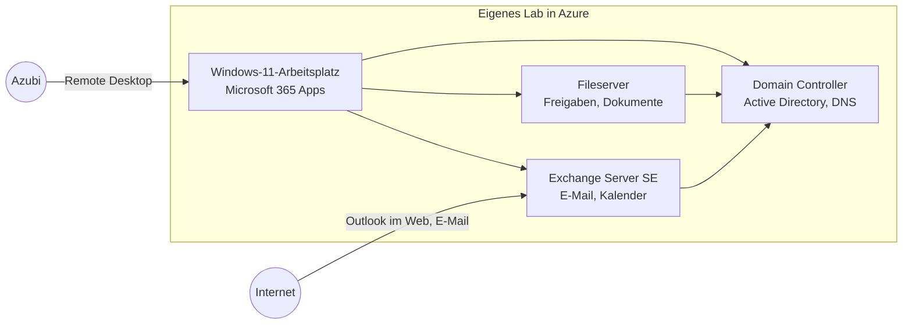

# Trainee Lab (Azure)

Eine komplette Microsoft-Firmenumgebung zum Lernen und Üben, per Klick in Azure.

*A complete Microsoft company environment for learning and practice, deployed to Azure in one click.*

**[Deutsch](#deutsch) · [English](#english)**

## Inhalt / Contents

- [Deutsch](#deutsch)
  - [Wozu das Ganze?](#wozu-das-ganze)
  - [Für wen?](#für-wen)
  - [Was steckt drin?](#was-steckt-drin)
  - [Was lässt sich üben?](#was-lässt-sich-üben)
  - [Schnellstart](#schnellstart)
  - [Kosten](#kosten)
  - [Dokumentation](#dokumentation)
  - [Hinweis für Betreiber](#hinweis-für-betreiber)
  - [Unterstützen](#unterstützen)
  - [Lizenz](#lizenz)
- [English](#english)
  - [What is it for?](#what-is-it-for)
  - [Who is it for?](#who-is-it-for)
  - [What is inside?](#what-is-inside)
  - [What can you practise?](#what-can-you-practise)
  - [Quick start](#quick-start)
  - [Costs](#costs)
  - [Documentation](#documentation)
  - [Note for operators](#note-for-operators)
  - [Support the project](#support-the-project)
  - [Licence](#licence)

## Deutsch

Das Trainee Lab baut in Azure die IT einer fiktiven Firma auf, fertig eingerichtet: Active Directory, Exchange Server, Fileserver und einen Windows-11-Arbeitsplatz mit Microsoft 365 Apps. Mitarbeitende, Postfächer, Abteilungsordner und zwölf Jahre Firmendokumente sind schon da. Hier darf geübt, ausprobiert, kaputtgemacht und neu aufgesetzt werden, ohne dass ein produktives System etwas davon merkt.

### Wozu das Ganze?

Wer IT-Infrastruktur lernt, braucht eine Umgebung, in der Fehler erlaubt sind. Echte Systeme sind dafür tabu. Ein Lab von Hand aufzubauen kostet Ausbilder viel Zeit und sieht am Ende bei jedem Azubi ein bisschen anders aus.

Das Trainee Lab löst das:

- **Immer wieder dieselbe Umgebung.** Jedes Deployment liefert denselben Ausgangsstand, ohne Handarbeit. Alle Azubis starten gleich, Ergebnisse sind vergleichbar.
- **Kaputtmachen erlaubt.** Ist das Lab verkonfiguriert, wird es gelöscht und neu bereitgestellt. Danach ist alles wieder wie am ersten Tag.
- **Realistisch statt leer.** Statt einer leeren Domäne gibt es eine Firma mit Standorten, Mitarbeitenden, Verteilern, Freigaben, Dokumenten und den typischen Altlasten gewachsener Umgebungen.
- **Ein eigenes Lab pro Azubi**, getrennt von allen anderen und von der Firmen-IT.

### Für wen?

#### IT-Leiter

- Jedes Lab läuft abgeschottet in einer eigenen Azure-Ressourcengruppe, ohne Verbindung zur Produktivumgebung und zum Firmen-Tenant.
- Keine Global-Admin-Rechte nötig: Die Azubis brauchen nur Rechte auf ihre eigene Ressourcengruppe und die gemeinsame DNS-Zone.
- Kosten planbar: Die Server schalten sich abends selbst ab, der Fileserver verkleinert sich nach dem Aufbau.
- Von außen nur von freigegebenen IP-Adressen erreichbar.
- Aktuelle, supportete Versionen: Exchange Server SE, Windows Server 2025, Windows 11.
- Lizenzen: Windows 11 in Azure und Microsoft 365 Apps brauchen passende Firmenlizenzen, Exchange läuft ohne Product Key 180 Tage als Testversion. Details in der [Bereitstellung](docs/de/deployment.md#voraussetzungen).

#### Ausbildungsleiter

- Immer wieder dieselbe Umgebung für alle Azubis, gut für gemeinsame Übungen und vergleichbare Ergebnisse.
- Wahlweise auf Deutsch (Mustermann Medien GmbH) oder Englisch (Contoso Ltd).
- Das Lab baut sich ohne Eingriff auf und lässt sich am Ende automatisch auf Vollständigkeit prüfen.
- Abbau und Neuaufbau jederzeit, zum Beispiel für jeden neuen Jahrgang.
- Grundlage für eigene Übungen, von der Benutzerverwaltung bis zur Migration in die Cloud.

#### Auszubildende

- Eine Firma zum Anfassen: Kolleginnen und Kollegen mit Postfach, Abteilungen, Verteiler, Besprechungsräume, Freigaben und jede Menge Dokumente.
- Einstieg wie im Büro: Anmeldung am eigenen Windows-11-Arbeitsplatz mit Outlook, Word und Co., von dort weiter auf alle Server.
- Ausprobieren ohne Angst: Was kaputtgeht, ist nach einem Neuaufbau wieder da.
- Echte Aufgaben statt Trockenübung: gewachsene Berechtigungen, alte Dateien und Datenschutzprobleme warten aufs Aufräumen.

#### Microsoft-Interessierte

- Aktueller On-Premises-Stack: Active Directory, Exchange Server SE, Windows Server 2025, Windows 11 mit Microsoft 365 Apps.
- Eigene öffentliche Maildomain mit echtem Zertifikat von Let's Encrypt, wie in einer richtigen Firma.
- Komplett als Code im Repository: nachvollziehbar, wie sich eine solche Umgebung automatisch aufbauen lässt.
- Ausgangslage für den Weg in die Cloud: Entra Connect, Exchange Hybrid, SharePoint Online.

### Was steckt drin?

- **Die Firma:** eine fiktive Werbeagentur, auf Deutsch die Mustermann Medien GmbH mit Standorten in Berlin und Hamburg, auf Englisch die Contoso Ltd in London und Manchester.
- **Die Mitarbeitenden:** 28 Benutzer mit Postfach, Abteilung, Vorgesetzten und Telefonnummern, darunter die 16 bekannten Microsoft-Demo-Personas wie Adele Vance oder Megan Bowen.
- **Die Server:**
  - Domain Controller mit Active Directory und DNS, auf Wunsch ein zweiter für Ausfallsicherheit
  - Exchange Server SE mit Postfächern, Verteilern, freigegebenen Postfächern, Besprechungsräumen und Outlook im Web
  - Fileserver mit Abteilungs-, Projekt-, Archiv- und Scan-Freigaben sowie persönlichen Basisordnern
  - Windows-11-Arbeitsplatz mit Microsoft 365 Apps, fertig eingerichtetem Outlook und Remote Desktop Manager für den Weg zu allen Servern
- **Die Daten:** rund 230 GB Word-, Excel-, PowerPoint- und PDF-Dateien aus zwölf Jahren Firmengeschichte, von Kundenprojekten über Buchhaltung und Personal bis zum Corporate Design.
- **Die Altlasten:** absichtlich eingebaut, wie in jeder gewachsenen Umgebung: Kopien und alte Versionen, Rechte für einzelne Benutzer statt Gruppen, Bewerbungen für alle lesbar, Rechte eines längst gelöschten Praktikanten, ein privater Ordner, auf den kein Admin zugreifen kann, und eine Scan-Freigabe mit Vollzugriff für jeden.

### Was lässt sich üben?

Vom eigenen Rechenzentrum bis in die Cloud, zum Beispiel:

- **Active Directory:** Benutzer, Gruppen und OUs verwalten, Gruppenrichtlinien, Standorte, zweiter Domain Controller und Ausfallsicherheit, gelöschte Objekte wiederherstellen
- **DNS und Zertifikate:** interne und öffentliche Namensauflösung, Zertifikate erneuern und einbinden
- **Exchange:** Postfächer, Verteiler, freigegebene Postfächer und Räume, Berechtigungen, Updates
- **Fileserver:** Freigaben und Berechtigungen nach AGDLP, Altlasten finden, bewerten und beheben, Datenschutz
- **Hybrid:** Entra Connect zur Synchronisierung mit einem eigenen Microsoft-365-Testtenant (nicht dem Firmen-Tenant), Exchange Hybrid und Postfachmigration nach Exchange Online
- **Cloud-Migration:** Dateien vom Fileserver nach SharePoint Online bringen

### Schnellstart

1. **Vorbereiten:** Azure-Subscription mit Rechten auf eine eigene Ressourcengruppe, Kürzel und DNS-Zone vom Ausbilder, die eigene öffentliche IP-Adresse sowie passende Lizenzen für Windows 11 und Microsoft 365 Apps.
2. **Bereitstellen:** Oben auf *Deploy to Azure* klicken und das Formular ausfüllen.
3. **Abwarten:** Das Lab baut sich ohne Eingriff auf, inklusive Updates und Beispieldaten. Das dauert mehrere Stunden, deshalb am besten morgens starten.
4. **Loslegen:** Per Remote Desktop am Windows-11-Arbeitsplatz anmelden, von dort geht es zu allen Servern.

Alle Voraussetzungen, Einstellungen und ersten Schritte: [Bereitstellung](docs/de/deployment.md).

### Kosten

Das Lab läuft in der eigenen Azure-Subscription und kostet, solange es existiert. Größter Posten ist der Exchange-Server. Damit es günstig bleibt:

- Exchange-Server, Arbeitsplatz und Fileserver schalten sich jeden Abend selbst ab. Abgeschaltete Server kosten nur noch ihren Speicher.
- Der Domain Controller ist klein und läuft bewusst durch, damit das Active Directory stabil bleibt.
- Der Fileserver arbeitet nur beim Aufbau mit mehr Leistung und verkleinert sich danach selbst.
- Wird das Lab nicht mehr gebraucht, wird es komplett gelöscht.

Budgets, vorzeitiges Abschalten und Abbau: [Betrieb](docs/de/operations.md#kosten-im-blick-behalten).

### Dokumentation

| Dokument | Für | Inhalt |
| --- | --- | --- |
| [Bereitstellung](docs/de/deployment.md) | alle, die ein Lab aufsetzen | Voraussetzungen, Rechte, Lizenzen, Parameter, Dauer, erste Schritte |
| [Architektur](docs/de/architecture.md) | IT-Leiter, Technikinteressierte | Aufbau, Netzwerk, Server, Ablauf und Logs, Supportbarkeit, Zertifikat |
| [Betrieb](docs/de/operations.md) | Azubis, Ausbilder | Starten und Stoppen, neue IP-Adresse, Lab prüfen, Fileserver, Kosten, Abbau |
| [Troubleshooting](docs/de/troubleshooting.md) | Azubis, Ausbilder | Hilfe, wenn etwas nicht läuft |
| [Entwicklung](docs/de/development.md) | Mitwirkende | Aufbau des Repositorys, Build, Tests, Abnahme |
| [Textkorpus](scripts/data/README.md) | Mitwirkende | Regeln für die Beispieldokumente |

### Hinweis für Betreiber

Ältere Versionen dieses Templates haben ein Service-Principal-Secret für Let's Encrypt im Klartext übergeben. Das Secret steht in der Deployment-Historie aller damit erstellten Ressourcengruppen. **Secret rotieren oder den Service Principal löschen**, falls noch nicht geschehen.

### Unterstützen

Das Lab ist kostenlos und quelloffen. Wer die Weiterentwicklung unterstützen möchte, kann das über [Buy Me a Coffee](https://buymeacoffee.com/sredlin) tun. Danke!

### Lizenz

[MIT](LICENSE). Exchange Server, Microsoft 365 Apps, CSS-Exchange und weitere Software lädt das Lab zur Laufzeit von den Herstellern. Dafür gelten deren Lizenzbedingungen.

## English

Trainee Lab builds the IT of a fictional company in Azure, fully set up: Active Directory, Exchange Server, a file server and a Windows 11 workstation with Microsoft 365 Apps. Staff, mailboxes, department folders and twelve years of company documents are already in place. Here you can practise, experiment, break things and start over, without any production system noticing.

### What is it for?

Anyone learning IT infrastructure needs an environment where mistakes are allowed. Real systems are off limits for that. Building a lab by hand takes trainers a lot of time and ends up slightly different for every trainee.

Trainee Lab solves this:

- **The same environment, every time.** Every deployment delivers the same starting point, with no manual work. All trainees start equal, results are comparable.
- **Breaking things is allowed.** If the lab is misconfigured, delete it and deploy it again. Everything is back to day one.
- **Realistic, not empty.** Instead of an empty domain there is a company with sites, staff, distribution groups, shares, documents and the typical legacy issues of environments that have grown over time.
- **One lab per trainee**, separate from everyone else and from the company IT.

### Who is it for?

#### IT managers

- Each lab runs isolated in its own Azure resource group, with no connection to the production environment or the company tenant.
- No Global Administrator rights needed: trainees only need permissions on their own resource group and the shared DNS zone.
- Predictable costs: the servers shut down by themselves in the evening, the file server shrinks after setup.
- Reachable from outside only from approved IP addresses.
- Current, supported versions: Exchange Server SE, Windows Server 2025, Windows 11.
- Licences: Windows 11 in Azure and Microsoft 365 Apps need suitable company licences; without a product key, Exchange runs as a 180-day trial. Details in [Deployment](docs/en/deployment.md#prerequisites).

#### Training managers

- The same environment for all trainees, every time: good for joint exercises and comparable results.
- In English (Contoso Ltd) or German (Mustermann Medien GmbH).
- The lab builds itself without intervention and can be checked automatically for completeness at the end.
- Tear down and rebuild at any time, for example for each new intake.
- A basis for your own exercises, from user management to migration to the cloud.

#### Trainees

- A company you can get your hands on: colleagues with mailboxes, departments, distribution groups, meeting rooms, shares and plenty of documents.
- Start like in the office: sign in to your own Windows 11 workstation with Outlook, Word and co., and continue from there to all servers.
- Experiment without fear: whatever breaks is back after a rebuild.
- Real tasks rather than dry runs: grown permissions, old files and data protection issues are waiting to be cleaned up.

#### Microsoft enthusiasts

- Current on-premises stack: Active Directory, Exchange Server SE, Windows Server 2025, Windows 11 with Microsoft 365 Apps.
- Own public mail domain with a real certificate from Let's Encrypt, just like a real company.
- Entirely as code in the repository: see how such an environment can be built automatically.
- Starting point for the journey to the cloud: Entra Connect, Exchange Hybrid, SharePoint Online.

### What is inside?

- **The company:** a fictional advertising agency; in English Contoso Ltd with offices in London and Manchester, in German Mustermann Medien GmbH in Berlin and Hamburg.
- **The staff:** 28 users with mailbox, department, manager and phone numbers, including the 16 well-known Microsoft demo personas such as Adele Vance or Megan Bowen.
- **The servers:**
  - Domain controller with Active Directory and DNS, optionally a second one for resilience
  - Exchange Server SE with mailboxes, distribution groups, shared mailboxes, meeting rooms and Outlook on the web
  - File server with department, project, archive and scan shares plus personal home folders
  - Windows 11 workstation with Microsoft 365 Apps, Outlook ready to use and Remote Desktop Manager to reach all servers
- **The data:** around 230 GB of Word, Excel, PowerPoint and PDF files from twelve years of company history, from client projects through accounting and HR to corporate design.
- **The legacy issues:** built in on purpose, as in any environment that has grown over time: copies and old versions, permissions for individual users instead of groups, job applications readable by everyone, permissions of an intern deleted long ago, a private folder no admin can access, and a scan share with full control for everyone.

### What can you practise?

From your own data centre to the cloud, for example:

- **Active Directory:** manage users, groups and OUs, Group Policy, sites, a second domain controller and resilience, restore deleted objects
- **DNS and certificates:** internal and public name resolution, renew and bind certificates
- **Exchange:** mailboxes, distribution groups, shared mailboxes and rooms, permissions, updates
- **File server:** shares and permissions following AGDLP, find, assess and fix legacy issues, data protection
- **Hybrid:** Entra Connect to synchronise with your own Microsoft 365 test tenant (not the company tenant), Exchange Hybrid and mailbox migration to Exchange Online
- **Cloud migration:** move files from the file server to SharePoint Online

### Quick start

1. **Prepare:** an Azure subscription with permissions on your own resource group, initials and DNS zone from your trainer, your own public IP address and suitable licences for Windows 11 and Microsoft 365 Apps.
2. **Deploy:** click *Deploy to Azure* at the top and fill in the form.
3. **Wait:** the lab builds itself without intervention, including updates and sample data. This takes several hours, so it is best to start in the morning.
4. **Get going:** sign in to the Windows 11 workstation via Remote Desktop; from there you can reach all servers.

All prerequisites, settings and first steps: [Deployment](docs/en/deployment.md).

### Costs

The lab runs in your own Azure subscription and incurs costs as long as it exists. The largest item is the Exchange server. To keep it affordable:

- Exchange server, workstation and file server shut down by themselves every evening. Servers that are shut down only cost their storage.
- The domain controller is small and deliberately keeps running so that Active Directory stays stable.
- The file server only runs with more power during setup and shrinks itself afterwards.
- When the lab is no longer needed, it is deleted completely.

Budgets, early shutdown and removal: [Operations](docs/en/operations.md#keep-an-eye-on-costs).

### Documentation

| Document | For | Contents |
| --- | --- | --- |
| [Deployment](docs/en/deployment.md) | anyone setting up a lab | prerequisites, permissions, licences, parameters, duration, first steps |
| [Architecture](docs/en/architecture.md) | IT managers, the technically curious | design, network, servers, sequence and logs, supportability, certificate |
| [Operations](docs/en/operations.md) | trainees, trainers | start and stop, new IP address, check the lab, file server, costs, removal |
| [Troubleshooting](docs/en/troubleshooting.md) | trainees, trainers | help when something does not work |
| [Development](docs/en/development.md) | contributors | repository layout, build, tests, acceptance |
| [Text corpus](scripts/data/README.md) (German) | contributors | rules for the sample documents |

### Note for operators

Older versions of this template passed a service principal secret for Let's Encrypt in plain text. The secret is stored in the deployment history of all resource groups created with those versions. **Rotate the secret or delete the service principal** if you have not already done so.

### Support the project

The lab is free and open source. If you would like to support its further development, you can do so via [Buy Me a Coffee](https://buymeacoffee.com/sredlin). Thank you!

### Licence

[MIT](LICENSE). The lab downloads Exchange Server, Microsoft 365 Apps, CSS-Exchange and other software from the vendors at runtime. Their licence terms apply.
